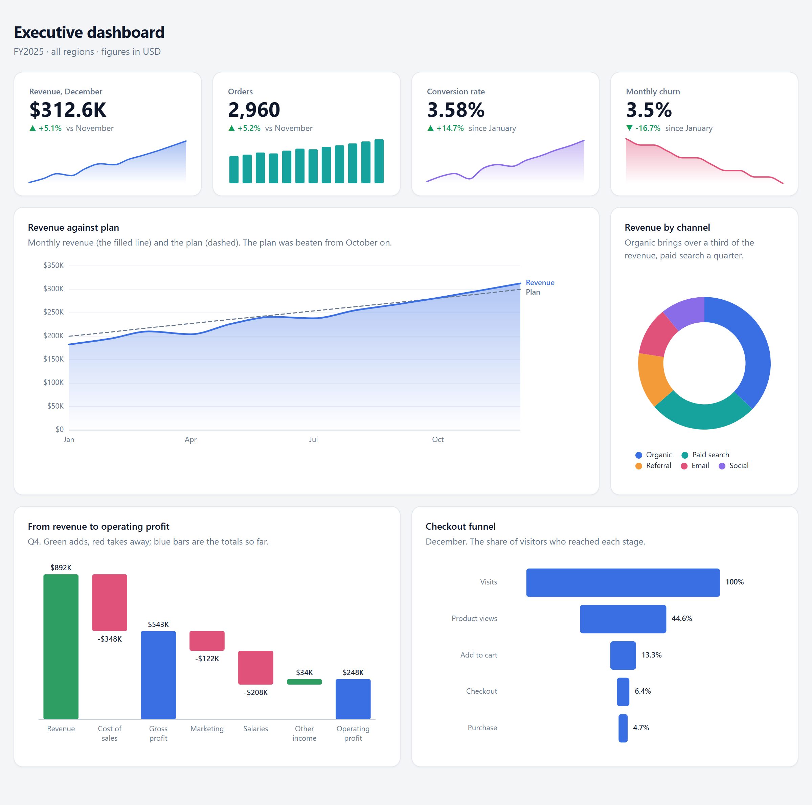

# blockcharts

[](https://www.npmjs.com/package/blockcharts)
[](https://github.com/boligolov/blockcharts/actions/workflows/ci.yml)
[](LICENSE)

**Atomic charts for HTML dashboards: a page carries only the chart code it needs. Nothing more.**

blockcharts is a chart library cut into atoms — a scale, a bar, an axis, a tooltip, each a block of <!-- build:block-range -->0.4–12 KB<!-- /build -->.
A page gets the core (about <!-- build:core-gzip -->12 KB<!-- /build --> gzipped) and exactly the blocks its own charts use, never the whole library.
Charts are described in JSON, drawn in SVG or on a canvas, and every part can be customized, down to blocks of your own.

**[Website](https://blockcharts.online)** · **[Gallery](https://blockcharts.online/examples/)** · **[Guide](https://blockcharts.online/guide/)** · **[Blocks](https://blockcharts.online/blocks/)** · [Principles](docs/spec/principles.md)

[](https://blockcharts.online/examples/executive-dashboard/)

*KPI tiles, a trend against plan, a donut, a waterfall and a funnel: one standalone HTML file,
[live in the gallery](https://blockcharts.online/examples/executive-dashboard/).*

## Quick start

One script tag, and a chart described in JSON where it should appear:

```html
<script src="https://cdn.jsdelivr.net/npm/blockcharts@0.0.2/release/kits/basic.js"></script>

<script type="application/json" id="bc-data">
  { "sales": [ { "region": "North", "total": 42 }, { "region": "South", "total": 58 }, { "region": "East", "total": 31 } ] }
</script>
<script type="application/json" data-bc-chart>
  { "data": "sales",
    "scales": { "x": { "type": "band" }, "y": { "type": "linear", "zero": true } },
    "guides": [ { "type": "axis", "scale": "x" }, { "type": "axis", "scale": "y" } ],
    "marks": [ { "type": "rect", "x": "region", "y": "total" } ],
    "interaction": [ { "type": "tooltip" } ] }
</script>
```

Charts draw themselves when the page loads. With a bundler or a framework:

```sh
npm install blockcharts
```

```js
import BC from 'blockcharts';

BC.data('sales', rows);
const chart = BC.chart(document.getElementById('chart'), spec); // update, setView, getView, destroy, ready
```

## Why blockcharts

- **Only the code your charts use.** The blocks a page needs are read from its specs and closed over their
  dependencies: a bar chart with labels and a tooltip carries <!-- build:bar -->10 of the 58 blocks, 71 KB of code instead of 214<!-- /build -->; a whole
  executive dashboard (KPI tiles, a trend, a donut, a waterfall, a funnel, animated) carries <!-- build:dashboard-blocks -->24<!-- /build -->. Nobody lists
  blocks by hand, so the list is never too long.
- **Charts are data, checked before they are drawn.** A chart is a plain JSON spec, not code. It is checked against
  the real data, and every mistake comes back with its place in the JSON.
- **One file that opens anywhere.** The composer turns JSON and data into a single HTML report that opens from disk,
  offline, can be emailed or printed, and loads nothing from the network. The same input always gives the same bytes.
- **Customizable at every level.** Block parameters (formats, locales, axes, tooltips), CSS variables and classes
  (brand colors, dark mode, print), your own set of blocks, functions by name (`BC.defineFn`), and blocks of your
  own — a small script calling `BC.define`, the same contract the built-in blocks use
  ([an example](https://blockcharts.online/embed/block/)).
- **Heavy data stays light.** A canvas renderer for tens of thousands of points, decimation, aggregation, and large
  datasets stored gzipped in the page.
- **No dependencies.** Plain ES2020 in every modern browser, typed for TypeScript, MIT-licensed.

What it is built on: [the blockcharts principles](docs/spec/principles.md), v<!-- build:principles-version -->1.1<!-- /build -->.

## What it draws

Bars (stacked, grouped, 100%), lines and areas, scatter and bubbles, hexbins and density contours, pie and donut,
heatmaps and calendars, histograms, boxplots and violins, waterfalls, funnels, treemaps, sankey and marimekko
diagrams, candlesticks, KPI tiles with sparklines, bullet and target lines — with tooltips, a crosshair, zoom and
brush, legend filters and animation.

Every kind is live in the [gallery](https://blockcharts.online/examples/), with its JSON and the HTML to embed it. The
<!-- build:recipes -->48<!-- /build --> ready-made pages behind it are in [`skills/blockcharts/recipes/`](skills/blockcharts/recipes/), to copy.

## Ways to ship it

| You want | Use |
| --- | --- |
| Charts in your own page, one `<script>` | a **kit**: the core and a set of blocks in one file |
| Each page to fetch only what it uses | the **loader**: `loader.js`, the core and single block files |
| A bundler or a framework component | the **npm package**: `import BC from 'blockcharts'` |
| One report file, nothing to host | the **composer**: JSON and data in, one HTML file out |

### Kits

A kit is the core and a set of blocks in one file: a classic script (`kits/<name>.js`) or an ES module
(`kits/<name>.mjs`, `export default BC`; browsers load modules over http and https only, not from `file://`).

<!-- build:kits -->

| Kit | Blocks | Contents | Minified (gzip) |
|---|---|---|---|
| `basic` | 19 | Bars, lines, points and areas on linear, log, time and band scales, with axes, grid, legend and tooltip, and fields calculated from the data. | 112 KB (42 KB) |
| `timeseries` | 29 | Long series over time: lines and areas with zoom, brush, legend filter, decimation, aggregation, wide tables and moving averages; also the canvas renderer for very large series. | 141 KB (52 KB) |
| `composition` | 33 | Parts of a whole and distributions: stacked bars and areas, pie, heatmap, histogram, boxplot, waterfall, funnel, treemap, aggregation. | 149 KB (54 KB) |
| `dashboard` | 31 | Business dashboards: KPI tiles with sparklines, bars, lines and areas, waterfall, funnel, treemap, bullet and target lines, donut, with axes, grid, legend, tooltip and legend filter. | 149 KB (55 KB) |
| `full` | 58 | Every block. | 226 KB (81 KB) |

<!-- /build -->

Everything is minified (esbuild, ES2020) and stripped of the parameter docs, which a running chart never reads.
Charts mount themselves on `DOMContentLoaded`; or call `BC.chart(element, spec)` and keep the handle.

### The loader

```html
<script src="https://cdn.jsdelivr.net/npm/blockcharts@0.0.2/release/loader.js" data-auto></script>
<!-- your data and <script data-bc-chart> specs -->
```

The loader reads `manifest.json` next to it, loads the core, asks it which blocks the charts on the page need, loads
only those (with their dependencies) and draws. By hand:

```js
await BCLoader.load({
  base: 'https://cdn.jsdelivr.net/npm/blockcharts@0.0.2/release/', // default: the folder of loader.js
  blocks: ['interaction.zoom'],   // extra blocks besides the ones found in the page
  scan: true,                     // find charts on the page (default)
  mount: true,                    // draw them when loaded (default)
  integrity: true,                // put the manifest's SRI hashes on the script tags
});
```

### npm

```sh
npm install blockcharts
```

```js
import BC from 'blockcharts';                    // the full kit, typed
import BC from 'blockcharts/kits/basic.mjs';     // a smaller kit
import manifest from 'blockcharts/manifest.json' with { type: 'json' };
const BC = require('blockcharts');               // CommonJS: the same full kit
```

The package carries the built files: kits, single blocks, the loader, the manifest and the types. Every kit has a
`.d.mts` (and a `.d.ts` for `require`); `blockcharts/bc.d.ts` declares the global `BC` and every spec type. A
`<script src>` names the file where it is: `node_modules/blockcharts/release/kits/basic.js`.

### CDN and integrity

jsDelivr and unpkg serve every file of the package at its path in it:
`https://cdn.jsdelivr.net/npm/blockcharts@<version>/release/<file>` (or `https://unpkg.com/blockcharts@<version>/release/<file>`),
where `<file>` is `core.js`, `blocks/<role.type>.js`, `kits/<name>.js` or `.mjs`, `loader.js`, `manifest.json` or
`bc.d.ts`. Pin an exact version (`@0.0.2`, not `@0` or `@latest`): files of a version never change, and
`manifest.json` lists a `sha384` hash of every file for the `integrity` attribute:

```html
<script src="https://cdn.jsdelivr.net/npm/blockcharts@0.0.2/release/kits/basic.js" integrity="sha384-..." crossorigin="anonymous"></script>
```

### The composer: one standalone report

The composer is a script of this repository, not part of the npm package: run it in a clone.

```sh
git clone https://github.com/boligolov/blockcharts.git
cd blockcharts
npm install
npm run build && npm run manifest
node scripts/compose.js skills/blockcharts/recipes/report-from-csv.json report.html
```

`page.json`:

```json
{
  "title": "Sales",
  "data": { "sales": [ { "region": "North", "total": 42 }, { "region": "South", "total": 58 } ] },
  "charts": [
    {
      "title": "Sales by region",
      "spec": {
        "data": "sales",
        "scales": { "x": { "type": "band" }, "y": { "type": "linear", "zero": true } },
        "guides": [ { "type": "grid", "scale": "y" }, { "type": "axis", "scale": "x" }, { "type": "axis", "scale": "y" } ],
        "marks": [ { "type": "rect", "x": "region", "y": "total" } ],
        "interaction": [ { "type": "tooltip" } ]
      }
    }
  ]
}
```

The composer works out which blocks the charts need, checks every spec against the data (an unknown field, a wrong
scale type, … each reported with its path in the JSON), draws each chart once in a sandbox to catch what only shows
up when drawing, and writes the page; nothing is written until every chart is valid. Having checked everything, the
page carries a lighter core, without the checks and, unless a dataset is stored gzipped, without the data decoder:
about <!-- build:core-saving -->14 KB<!-- /build --> less per report.

Datasets can be rows, `{"columns": {...}}`, `{"csv": "text"}`, or `{"csvFile": "orders.csv"}` (next to `page.json`);
large ones are stored gzipped automatically. A dashboard is the same file with a grid: `"layout": {"columns": 4}` and
a `span` per chart (KPI tiles `span: 1`, a trend `span: 3`), with a `title` and a `subtitle` on top. Every chart sits
in a card, and on a phone the cards stack.

## How a chart is described

```json
{
  "data": "sales",
  "size": [640, 320],
  "transforms": [ { "type": "aggregate", "groupby": ["region"], "measures": [ { "op": "sum", "field": "total", "as": "sum" } ] } ],
  "scales": { "x": { "type": "band" }, "y": { "type": "linear", "zero": true } },
  "guides": [ { "type": "axis", "scale": "y", "title": "Revenue", "format": { "style": "currency", "currency": "USD" } } ],
  "marks": [ { "type": "rect", "x": "region", "y": "sum" } ],
  "interaction": [ { "type": "tooltip" }, { "type": "zoom" } ]
}
```

Scales are declared once and named. Marks read data through channels (`"x": "region"` means the field `region` on
the scale named `x`). Guides attach to scales, not to marks, and several scales per direction are fine (a dual axis).
A block is named by its `type`, so `{"type": "rect"}` is `mark.rect`. Custom tooltip content is a function registered
with `BC.defineFn(name, fn)` and named in the spec (`"content": "name"`), so specs stay plain JSON.

## Blocks

The <!-- build:blocks -->58<!-- /build --> blocks, by role:

<!-- build:roles -->

| Role | Blocks |
|---|---|
| lib | `columns`, `curve`, `pointer`, `stats`, `ticks`, `view` (code other blocks share; a spec never names it) |
| scale | `band`, `color`, `linear`, `log`, `sequential`, `size`, `time` |
| transform | `aggregate`, `bin`, `calculate`, `calendar`, `contour`, `decimate`, `density`, `filter`, `fold`, `funnel`, `hexbin`, `highlight`, `marimekko`, `quartiles`, `sankey`, `sort`, `stack`, `treemap`, `waterfall`, `window` |
| mark | `arc`, `area`, `boxplot`, `candlestick`, `line`, `point`, `polygon`, `rect`, `rule`, `sankey`, `text`, `violin` |
| guide | `axis`, `grid`, `kpi`, `legend` |
| interaction | `animate`, `brush`, `crosshair`, `legend-filter`, `tooltip`, `zoom`, `zoom-controls` |
| renderer | `canvas`, `svg` |

<!-- /build -->

Every parameter of every block: [the block reference](https://blockcharts.online/blocks/), also in
[`skills/blockcharts/reference/blocks.md`](skills/blockcharts/reference/blocks.md).

## Browser support

Chrome and Edge 80, Firefox 74, Safari 14.1 or later: the code is ES2020, and compact numbers (`12K`) are `Intl`'s. A
dataset stored gzipped, which the composer does with a large one, is read with `DecompressionStream`: Firefox 113 and
Safari 16.4 (Chrome and Edge 80); an older browser shows a message in the chart's place. The composer needs Node 22+.

## Development

```sh
npm install
npm test             # build, then the core, blocks, canvas, composer, CSV, skill and release tests
npm run test:chrome  # layout in a real browser (the system Chrome)
npm run release      # kits, single blocks and the loader -> release/
npm run skill        # the skill's generated parts and the figures this README quotes
```

Layout, tests, the website and releasing: [docs/development.md](docs/development.md). What is left to do:
[ROADMAP.md](ROADMAP.md). Design decisions: [docs/Design.md](docs/Design.md).

## For AI agents: the blockcharts skill

An agent skill turns a table or a CSV file into one light `.html` report with interactive charts. The agent writes
only the JSON; the composer bundled with the skill checks every chart against the data and writes the page.

**Claude Code** — from this repository, which is a plugin marketplace:

```
/plugin marketplace add boligolov/blockcharts
/plugin install blockcharts@blockcharts
```

It updates by itself once auto-update is on for the marketplace (`/plugin` → *Marketplaces*), or by hand with
`claude plugin update blockcharts@blockcharts`.

**Claude.ai and Claude Desktop** — download **[blockcharts.skill](https://blockcharts.online/blockcharts.skill)**
and upload it under *Settings → Capabilities → Skills* (skills need code execution enabled).

**Any other agent that reads skill folders** — copy [`skills/blockcharts/`](skills/blockcharts/) into its skills
folder (`~/.claude/skills/` for Claude Code). It needs Node.js 22+.

Then ask — *"an HTML report of monthly revenue by region from sales.csv"*, *"a dashboard of these KPIs"*. Scopes and
details: [docs/skill.md](docs/skill.md). The skill is versioned apart from the library (`metadata.version` in
`SKILL.md`, `version` in its `plugin.json`), so that Claude Code offers each update.

## License

[MIT](LICENSE).
